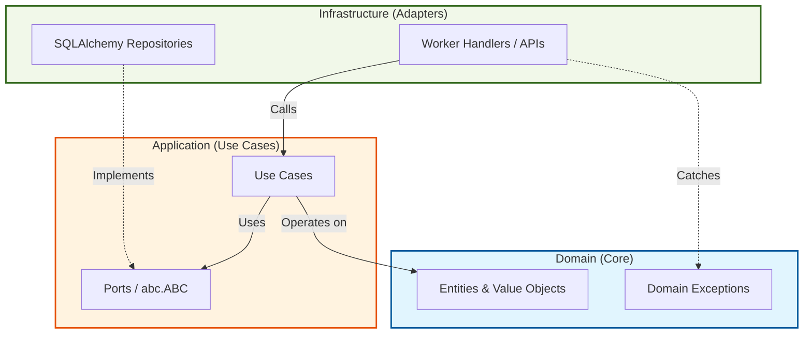

# Architecture Spine: xgplib-workers

## Overview

This project adheres strictly to **Clean Code and Hexagonal Architecture (Ports and Adapters)** principles. The goal of this spine is to document the invariants that prevent architectural drift, ensuring the core domain remains pure, testable, and completely decoupled from infrastructure concerns (frameworks, databases, external APIs).

## 1. Paradigm & Boundaries

- **Core Paradigm:** Hexagonal Architecture (Ports and Adapters).
- **Dependency Rule:** All dependencies must point inward toward the Domain. The Domain knows nothing about the Application layer, and the Application layer knows nothing about the Infrastructure layer.

## 2. Invariants (Architectural Decisions)

### AD-1: Boundary Enforcement
- **Binds:** Dependency Rule Enforcement.
- **Prevents:** Architectural drift where domain logic implicitly couples to infrastructure.
- **Rule:** Boundaries are enforced in three layers, each mechanical:
  1. **Folder convention** — the layers live at exactly `src/domain`, `src/application`, `src/infrastructure`.
  2. **Declarative contract** — the `layers` contract in `[tool.importlinter]` (`pyproject.toml`, listed top-to-bottom as highest→lowest: `infrastructure`, `application`, `domain`) fails the build when a lower layer imports a higher one. **Ruff** covers style and formatting only; it cannot scope banned imports by source module, so it is not the boundary mechanism.
  3. **Executable proof** — `tests/test_layers.py` pins the shipped contract by name, checks parity between the shipped and throwaway contracts, and exercises negative controls for every forbidden direction (`domain → infrastructure`, `domain → application`, `application → infrastructure`) plus a positive control for the permitted inward directions.
- **Note:** the subprocess-based boundary tests are deliberate, not accidental weight. The Story 1.1 review found the direction was never actually verified: the tests ran against a hardcoded copy of the contract rather than the shipped one, so an inverted `layers` order in `pyproject.toml` would have shipped with every test green (`37bb259` pinned the shipped contract and added the parity check). Do not remove the tests as "heavyweight".

### AD-2: Dependency Injection Strategy
- **Binds:** Dependency Injection Orchestration.
- **Prevents:** Hardcoded concrete infrastructure dependencies inside application use cases, which complicates testing and flexibility.
- **Rule:** Dependency Injection must be orchestrated via **`dependency-injector`** (distribution `dependency-injector`, import top-level `dependency_injector`) — not manual wiring, and not any other container. The container is declared once, in a single composition root inside `infrastructure`; `domain` and `application` classes receive their collaborators as plain constructor parameters and import nothing from the container library (AD-7). Application code never resolves services at call time and never reaches for a global container.
- **Trap to record:** the PyPI name `python-dependency-injector` is an unrelated stub package; the library is `dependency-injector`.

### AD-3: Port (Interface) Definition Standard
- **Binds:** Port (Interface) Definition Standard.
- **Prevents:** Inconsistent contract definitions or runtime failures from incomplete structural typing.
- **Rule:** Ports (the interfaces defining what the domain needs from infrastructure) must be defined using Python's native `abc.ABC` (Abstract Base Classes). This enforces explicit implementation and ensures fail-fast instantiation if an adapter is missing methods.

### AD-4: Use Case State Mutation Flow
- **Binds:** Use Case State Mutation Flow.
- **Prevents:** Overly complex functional workarounds or scattered state changes outside of controlled boundaries.
- **Rule:** Use Cases (Application layer) are responsible for orchestrating state mutation imperatively. The flow is standard: retrieve entities via ports, invoke domain logic on the entity, and explicitly call port methods (e.g., `save`) to persist the new state.

### AD-5: Error Handling Strategy
- **Binds:** Error Handling Strategy.
- **Prevents:** Infrastructure-level errors polluting the domain, or domain logic being bogged down by checking Result monads.
- **Rule:** Domain and Application layers raise explicit, custom Domain Exceptions (e.g., `DomainError`, `EntityNotFound`). The outermost layer (Adapters/Entrypoints) is exclusively responsible for catching these exceptions and translating them into the appropriate infrastructure response (e.g., specific logs, queue NACKs, HTTP codes).

### AD-6: Foundational Stack
- **Binds:** Foundational Stack.
- **Prevents:** Tooling sprawl and reinventing the wheel with non-standard libraries.
- **Rule:** We adopt industry-standard Python tooling as our base:
  - **SQLAlchemy:** For ORM and persistence in the Infrastructure layer.
  - **Pydantic:** For Data Transfer Objects (DTOs) and configuration validation.
  - **Ruff:** For fast, unified linting and formatting.
  - **import-linter:** For enforcing the inward-only dependency rule between layers.

### AD-7: Framework Isolation of Domain and Application
- **Binds:** Third-party coupling inside the inner layers.
- **Prevents:** The Domain and Application layers importing frameworks or drivers (SQLAlchemy, Pydantic, HTTP clients, DB drivers) and thereby losing purity, testability without infrastructure dependencies, and adapter swappability — the decoupling promised in the Overview.
- **Rule:** `domain` and `application` must not import third-party runtime libraries. Frameworks belong to `infrastructure`: SQLAlchemy models/repositories, Pydantic configuration and DTOs, and HTTP clients live there, and the inner layers reach them only through ports defined with `abc.ABC` (AD-3). Enforcement is one import-linter `forbidden` contract per guarded layer, whose enforceable form is narrower than the prose above — state it exactly:
  1. **`forbidden_modules` is an explicit, enumerated list of top-level import names.** import-linter has no "any external package" wildcard; a library missing from the list is not enforced at all, so "and any other runtime dependency" is not a contract, it is an intention.
  2. **`include_external_packages = true` is a top-level `[tool.importlinter]` session option, not a contract key.** Without it the contracts inspect first-party modules only and pass vacuously; setting it inside a contract is a configuration error.
  3. **The list is closed against the runtime dependency set.** Every dependency declared in `[project].dependencies` must map to an entry in the forbidden list — with an explicit distribution→import-name mapping where the two differ (`pydantic-settings` → `pydantic_settings`, `pyyaml` → `yaml`) — and the gate must fail when a declared dependency has no entry. This is what keeps the rule true as dependencies grow, rather than true only for the libraries someone remembered.
- **Rollout:** each contract lands together with the dependency it guards — Story 1.2 forbids `pydantic` and `dependency_injector` (AD-2) in `domain` and `application`; Story 1.3 extends the set with `sqlalchemy` and the PostgreSQL driver's import name.
- **Evidence:** every forbidden contract must have a matching negative control in `tests/test_layers.py` — a throwaway project whose `domain` (or `application`) imports the forbidden library must report that contract as `BROKEN`. A contract without its negative control is treated as unverified.

### AD-8: Synchronous Concurrency Model
- **Binds:** Port signatures, driver and HTTP client selection across every adapter.
- **Prevents:** Story 2.1 building a synchronous Microsoft adapter while Story 3.1 builds an asynchronous IGDB adapter — each internally consistent, neither callable through the same port nor from the same use case — and the retrofit that follows, which rewrites every port the epics already fixed.
- **Rule:** The system is synchronous end to end.
  1. **Inner layers are synchronous:** every port method and every use case is declared `def`. No `async def` appears under `src/domain` or `src/application`.
  2. **Adapters are synchronous at the boundary:** persistence uses SQLAlchemy's `Session`/`Engine`, never `AsyncSession`, on the **psycopg 3** driver in sync mode; HTTP adapters use a synchronous client. Concurrency, where an adapter genuinely needs it, is an adapter-internal detail (a thread pool inside one adapter) that leaves the port surface untouched.
- **Why it binds (the trade-off):** a run is bounded by external rate limits — IGDB enforces a small per-second request cap and Microsoft hydration takes 200 ids per request (`SPEC.md:47`) — so overlapping I/O waits does not shorten the run. Async would buy the project an async test runner, async container factories and an `AsyncSession` lifecycle for no wall-clock gain. Reversing this decision is an AD change, not a local adapter choice.
- **Evidence:** a gate test asserts that no `async def` appears under `src/domain` and `src/application` (AST walk), alongside the existing boundary tests.

### AD-9: Entity Identity and Upsert Key
- **Binds:** The identity of every persisted entity, the conflict target of every upsert, and what "the same game" means across runs.
- **Prevents:** Two units that each pass their own tests while disagreeing about identity: an entity re-hydrated from the database carrying a freshly generated id, so the hourly run re-inserts a product that already exists; or a compensating `UNIQUE(product_id)` turning that duplicate into an `IntegrityError` the application cannot classify.
- **Rule:**
  1. **Identity is the store product id.** `games.product_id` — the Microsoft catalog product identifier — is the primary key. No surrogate UUID, no sequence-backed identity for games.
  2. **Identity is immutable.** A changed `product_id` is a *different* game, never an update; no adapter or mapper may rewrite a persisted one.
  3. **The upsert target is that key.** Repository writes are `INSERT … ON CONFLICT (product_id) DO UPDATE`, exposed as a single upsert operation. A use case must not read first to decide whether to insert or update — deciding identity is the repository's job, and read-then-write is the race that produces duplicates.
  4. **Rehydration carries the id.** An entity loaded from the database keeps the id it was stored with; nothing constructs a game with a fresh identifier.
  5. **IGDB's id is an attribute, never an identity.** A game exists in the catalog whether or not it matched IGDB. Matching later updates the row in place; a failed match is a row with no enrichment, not a second row and not a deleted one.
- **Evidence:** persistence tests (Story 4.1) that (a) persist the same batch twice and assert the row count and the ids are unchanged — idempotence by construction, not by convention; (b) enrich a previously unmatched game and assert it updates in place rather than duplicating.

## 3. Structural Design

## 4. Deferred Decisions

These are **open**, not settled. Until one is decided here, no story may settle it locally: a unit that needs one of these values raises it, it does not choose.

- **Availability model** — markets are decided (one run covers several configured markets), so availability must carry the market dimension; what is still open is the platform × plan grid: the three sigls endpoints (Console, PC, EA Play) do not map cleanly onto FR-1.1's platform × plan, since cloud is absent and EA Play is a benefit rather than a device. Which `(platform, plan)` rows each endpoint yields is for the Story 2.1 spike to establish.
- **JSONB ownership** — which writer owns which namespace of the metadata column (raw Microsoft payload vs IGDB enrichment), and does a write merge or replace?
- **Soft-deletion semantics** — with several markets per run, what "removed" means: absent from one market's fetch, or from all of them? And how a failed market fetch is prevented from being read as a removal.
- **Transaction boundary** — one commit per sync run, or per entity? What happens to a partially hydrated batch?
- **Resilience policy** — where retries and circuit breakers live, which library, where thresholds come from, and what "skip gracefully" (NFR-1) means for a use case. Constraint: SPEC requires circuit breakers and retries for external APIs.
- **Configuration & secrets** — how credentials and the database URL reach the process, and the precedence between an env file and the real environment.
- **Operational envelope** — deployment target, environments, how PostgreSQL is provisioned and what tests run against, and where the unmatched-title log for manual review is written.
- **Stack pins** — exact versions, Python baseline, migration tool, HTTP client library, and the date each was verified against the web.
- **Testing strategy** — port fakes vs recorded HTTP fixtures, ephemeral PostgreSQL, coverage gate.

---
*Generated by BMad Architecture Skill.*
