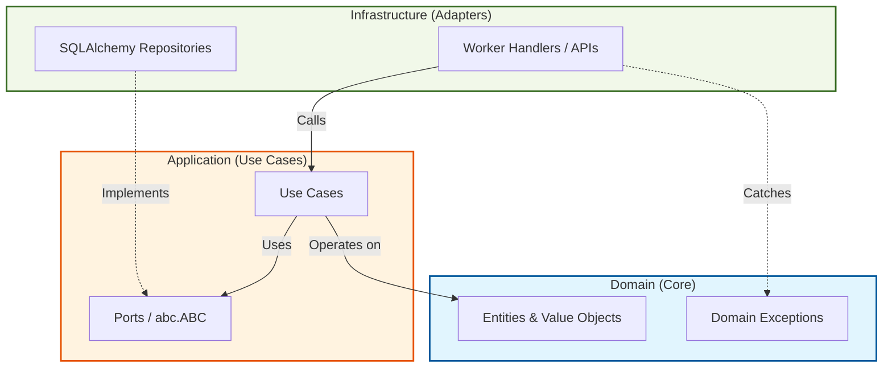

# Architecture Spine: xgplib-workers

## Overview

This project adheres strictly to **Clean Code and Hexagonal Architecture (Ports and Adapters)** principles. The goal of this spine is to document the invariants that prevent architectural drift, ensuring the core domain remains pure, testable, and completely decoupled from infrastructure concerns (frameworks, databases, external APIs).

## 1. Paradigm & Boundaries

- **Core Paradigm:** Hexagonal Architecture (Ports and Adapters).
- **Dependency Rule:** All dependencies must point inward toward the Domain. The Domain knows nothing about the Application layer, and the Application layer knows nothing about the Infrastructure layer.

## 2. Invariants (Architectural Decisions)

### AD-1: Boundary Enforcement
- **Binds:** Dependency Rule Enforcement.
- **Prevents:** Architectural drift where domain logic implicitly couples to infrastructure.
- **Rule:** Boundaries are enforced in three layers, each mechanical:
  1. **Folder convention** — the layers live at exactly `src/domain`, `src/application`, `src/infrastructure`.
  2. **Declarative contract** — the `layers` contract in `[tool.importlinter]` (`pyproject.toml`, listed top-to-bottom as highest→lowest: `infrastructure`, `application`, `domain`) fails the build when a lower layer imports a higher one. **Ruff** covers style and formatting only; it cannot scope banned imports by source module, so it is not the boundary mechanism.
  3. **Executable proof** — `tests/test_layers.py` pins the shipped contract by name, checks parity between the shipped and throwaway contracts, and exercises negative controls for every forbidden direction (`domain → infrastructure`, `domain → application`, `application → infrastructure`) plus a positive control for the permitted inward directions.
- **Note:** the subprocess-based boundary tests are deliberate, not accidental weight. They caught an inverted `layers` order that the declarative contract alone reported as kept (`37bb259`). Do not remove them as "heavyweight".

### AD-2: Dependency Injection Strategy
- **Binds:** Dependency Injection Orchestration.
- **Prevents:** Hardcoded concrete infrastructure dependencies inside application use cases, which complicates testing and flexibility.
- **Rule:** Dependency Injection must be orchestrated via a **DI Container framework** (rather than manual wiring). This standardizes how components receive their dependencies as the project scales, ensuring the Application layer only asks for abstractions.

### AD-3: Port (Interface) Definition Standard
- **Binds:** Port (Interface) Definition Standard.
- **Prevents:** Inconsistent contract definitions or runtime failures from incomplete structural typing.
- **Rule:** Ports (the interfaces defining what the domain needs from infrastructure) must be defined using Python's native `abc.ABC` (Abstract Base Classes). This enforces explicit implementation and ensures fail-fast instantiation if an adapter is missing methods.

### AD-4: Use Case State Mutation Flow
- **Binds:** Use Case State Mutation Flow.
- **Prevents:** Overly complex functional workarounds or scattered state changes outside of controlled boundaries.
- **Rule:** Use Cases (Application layer) are responsible for orchestrating state mutation imperatively. The flow is standard: retrieve entities via ports, invoke domain logic on the entity, and explicitly call port methods (e.g., `save`) to persist the new state.

### AD-5: Error Handling Strategy
- **Binds:** Error Handling Strategy.
- **Prevents:** Infrastructure-level errors polluting the domain, or domain logic being bogged down by checking Result monads.
- **Rule:** Domain and Application layers raise explicit, custom Domain Exceptions (e.g., `DomainError`, `EntityNotFound`). The outermost layer (Adapters/Entrypoints) is exclusively responsible for catching these exceptions and translating them into the appropriate infrastructure response (e.g., specific logs, queue NACKs, HTTP codes).

### AD-6: Foundational Stack
- **Binds:** Foundational Stack.
- **Prevents:** Tooling sprawl and reinventing the wheel with non-standard libraries.
- **Rule:** We adopt industry-standard Python tooling as our base:
  - **SQLAlchemy:** For ORM and persistence in the Infrastructure layer.
  - **Pydantic:** For Data Transfer Objects (DTOs) and configuration validation.
  - **Ruff:** For fast, unified linting and formatting.
  - **import-linter:** For enforcing the inward-only dependency rule between layers.

### AD-7: Framework Isolation of Domain and Application
- **Binds:** Third-party coupling inside the inner layers.
- **Prevents:** The Domain and Application layers importing frameworks or drivers (SQLAlchemy, Pydantic, HTTP clients, DB drivers) and thereby losing purity, testability without infrastructure dependencies, and adapter swappability — the decoupling promised in the Overview.
- **Rule:** `domain` and `application` must not import third-party runtime libraries. Frameworks belong to `infrastructure`: SQLAlchemy models/repositories, Pydantic configuration and DTOs, and HTTP clients live there, and the inner layers reach them only through ports defined with `abc.ABC` (AD-3). Enforcement is an import-linter `forbidden` contract per layer, with `include_external_packages = true` set — without that flag the contract silently ignores external packages and passes vacuously. Each contract lands together with the dependency it guards:
  - **Story 1.2 (Pydantic):** forbid `pydantic` (and any other runtime dependency) in `domain` and `application`.
  - **Story 1.3 (SQLAlchemy / DB driver):** extend the forbidden set with `sqlalchemy` and the PostgreSQL driver.
- **Evidence:** every forbidden contract must have a matching negative control in `tests/test_layers.py` — a throwaway project whose `domain` (or `application`) imports the forbidden library must report that contract as `BROKEN`. A contract without its negative control is treated as unverified.

## 3. Structural Design

## 4. Deferred Decisions
- *None explicitly deferred at this stage.*

---
*Generated by BMad Architecture Skill.*
